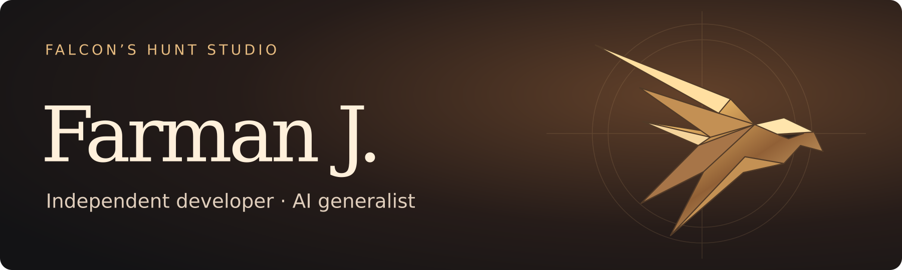

I’m Farman, a trader and web developer in Bangalore. I build tools for moments I know firsthand, like reviewing a tough trading session or looking up from my laptop and realizing I’ve forgotten to drink water.

## Try my work

**[Hunter’s Journal](https://farman024.github.io/Hunter-s-Journal/index.html)** · Trading journal  
Plan a session, record the trade, then look back at whether you followed your rules. Solo Leveling inspired the design. [View source ↗](https://github.com/farman024/Hunter-s-Journal)

**[Hydro Buddy](https://farman024.github.io/Hydro-Buddy/)** · Hydration assistant  
Log a glass between tasks. A voice reminder helps you catch the next one when you’re deep in work. [View source ↗](https://github.com/farman024/Hydro-Buddy)

**[Falcon Ledger](https://github.com/farman024/Falcon-Ledger)** · Offline finance tracker  
Track income, expenses, and recurring payments in a single-file web app. Your ledger stays on your device.

## Inside my workflow

I use JavaScript for the apps and Python for bots. ACE, my OpenCode companion, reads interface screenshots through Gemini and picks up project decisions from files I keep in each repo.

[Explore my AI skills on Agensi ↗](https://www.agensi.io/creators/farman024) · [Get in touch on Instagram ↗](https://www.instagram.com/farman_.24._/)
